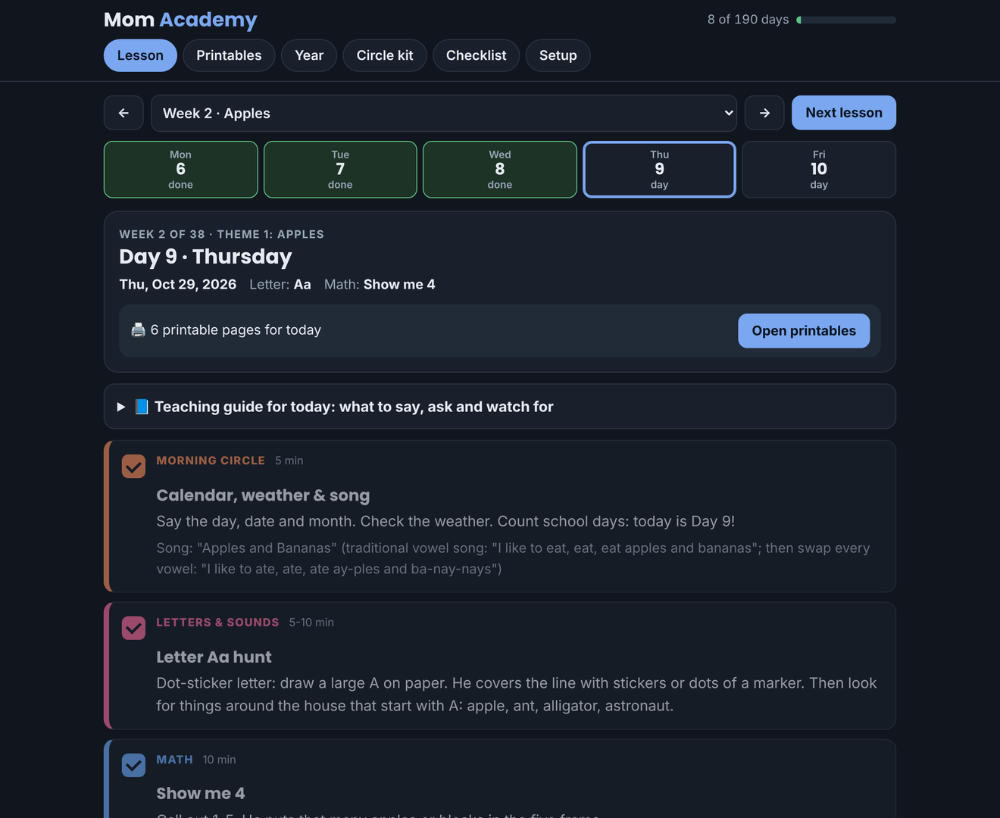
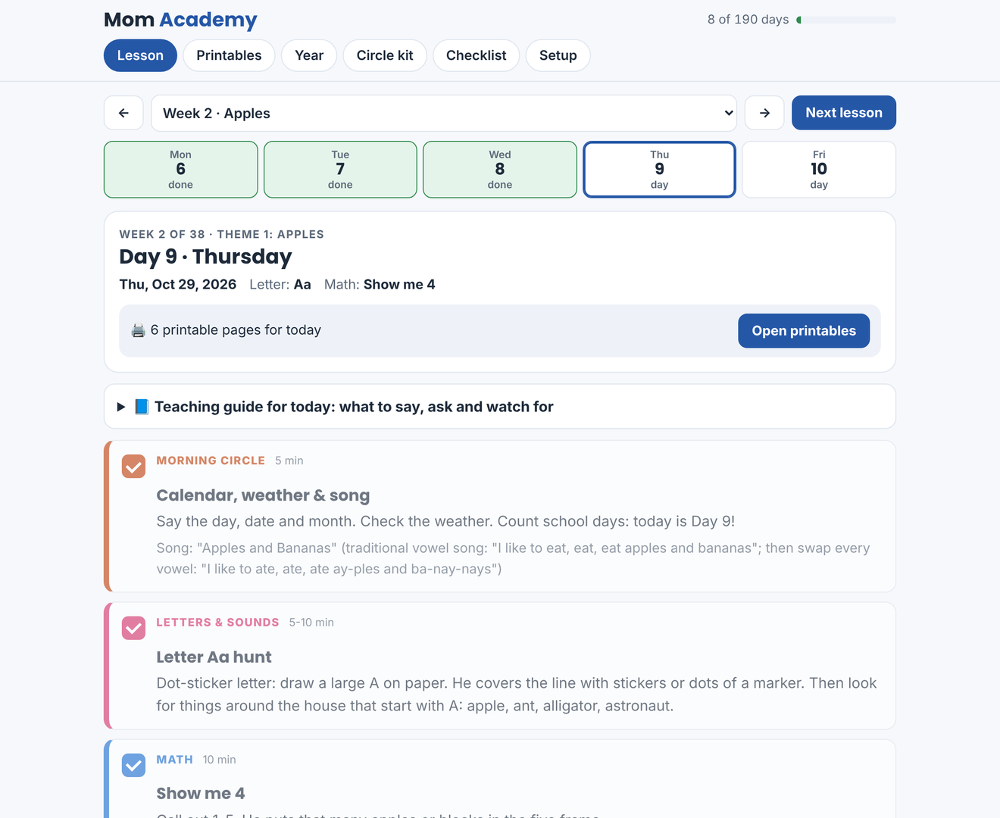
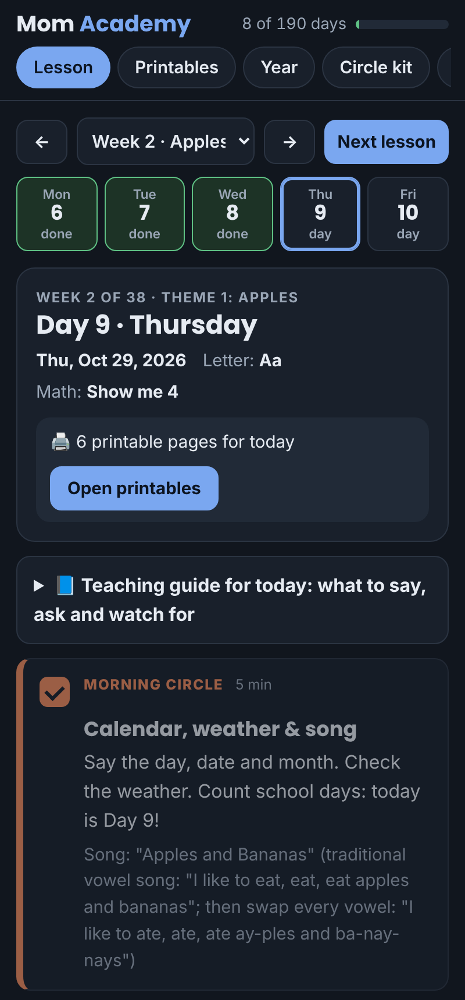
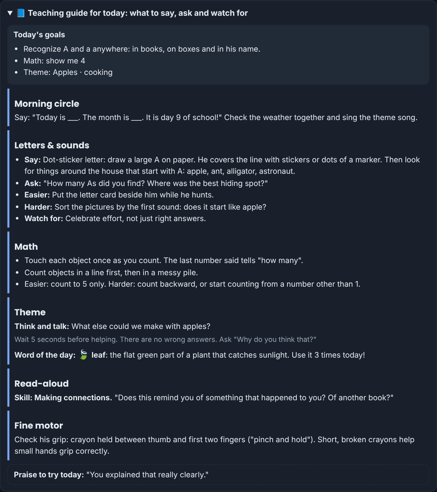
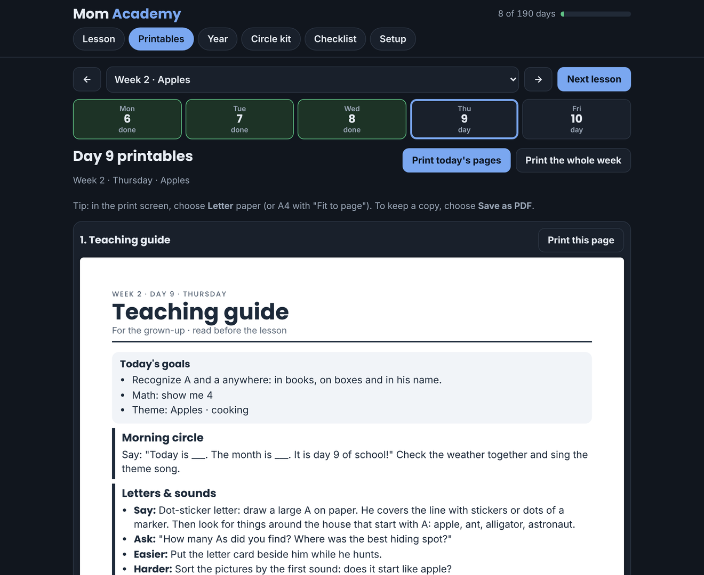
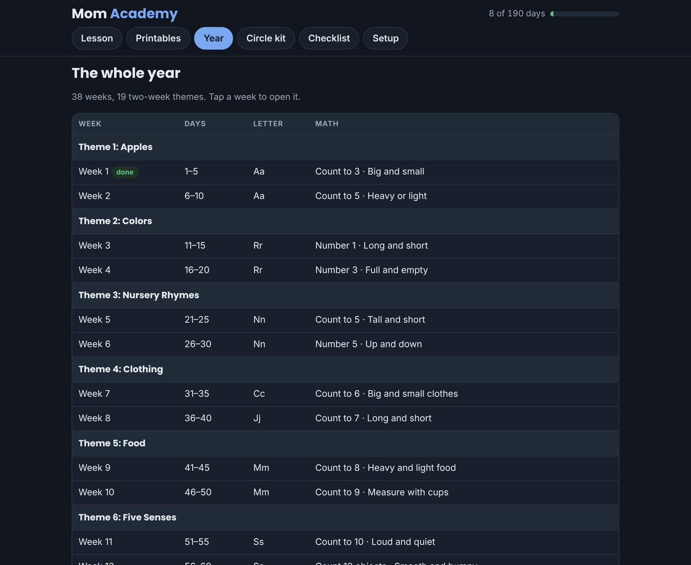
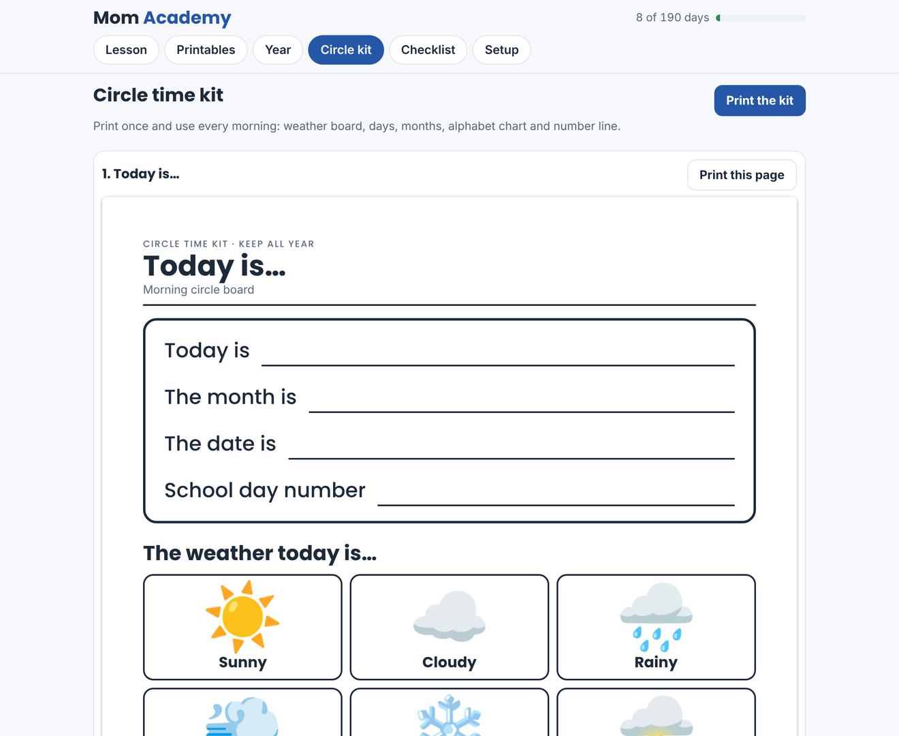
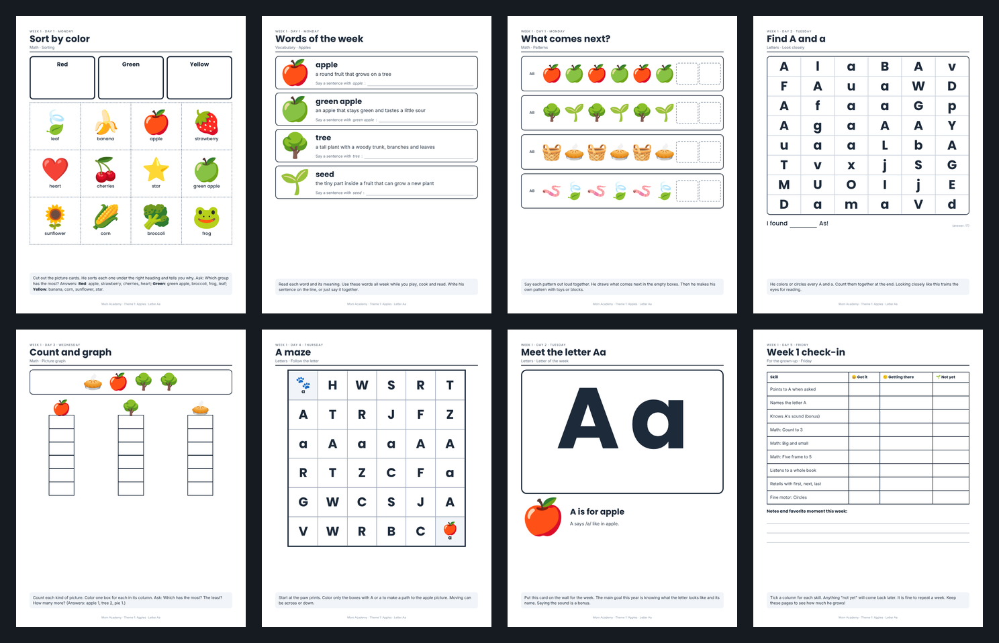
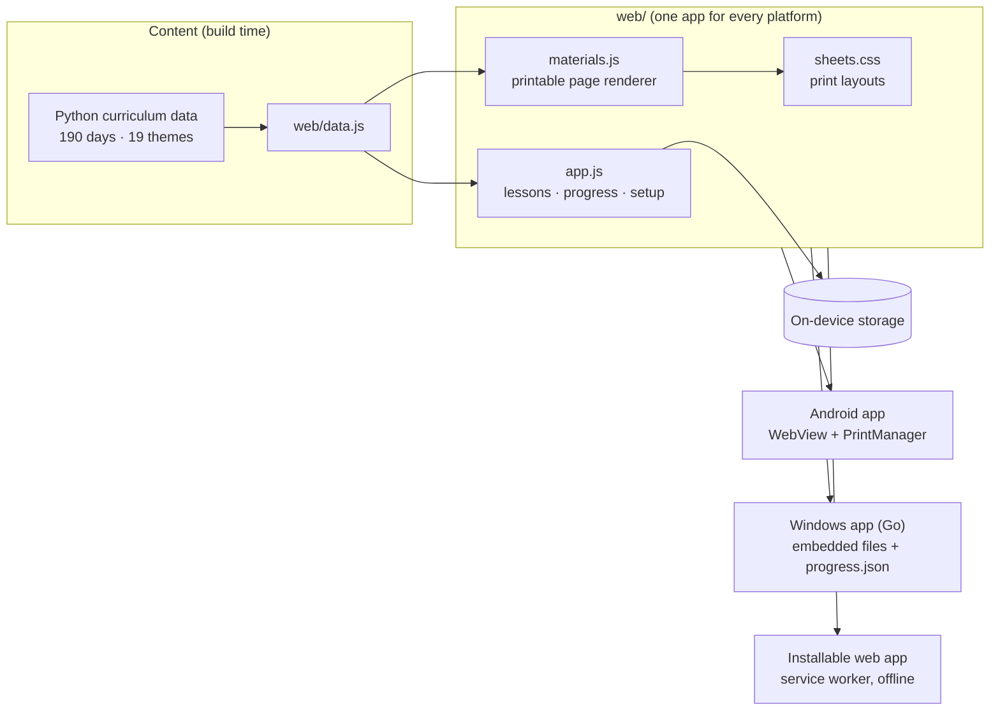

# Mom Academy: Homeschool Preschool App

     

Mom Academy is a free, offline homeschool app for preschoolers (ages 4–5). It turns a full school year into **190 short daily lessons across 38 weeks**. Each lesson has a morning circle, letter of the week, math, a theme activity, a read-aloud, fine-motor practice and a little app time. Every day also comes with a **teaching guide for the parent** and **ready-to-print study materials**: sorting mats, letter cards, mazes, ten frames, tracing pages and more.

It was built for one real family: a mom teaching her son at home who couldn't afford the long list of extra books a homeschool program asked for. So everything here uses free library books and everyday household supplies.

> **Download:** the [latest release](../../releases/latest) has the Android app (`MomAcademy.apk`) and the Windows app (`MomAcademy-Windows.zip`).



## Why I Built This

Preschool homeschool programs are often wonderful, but they assume you'll buy six picture books every two weeks, plan every activity yourself and figure out *how* to teach each skill. For a busy parent, that's the hard part.

Mom Academy does the planning. Open the app, tap **Next lesson**, and you'll see what to do today, what to say, which questions to ask, how to make it easier or harder, and which pages to print. The pace is deliberately gentle, play-based and pressure-free, so a four-year-old enjoys learning instead of being rushed.

## Features

- **190 daily lessons in 38 weeks:** 19 two-week themes (Apples, Colors, Nursery Rhymes … Water), each with its own song, supplies list and book ideas.
- **A predictable weekly rhythm:** Monday is sorting and predicting, Tuesday and Thursday are letters and numbers, Wednesday is measuring and comparing, and Friday is retelling, shapes and review.
- **A teaching guide for every day:** today's goals, what to say, what to ask, easier and harder versions, what to watch for, and a growth-mindset praise line.
- **190 "think and talk" questions:** one big question a day to build reasoning, not just memorizing.
- **Words of the week:** 152 theme words with kid-friendly meanings and a word of the day.
- **1,145 printable pages:** generated for every day of the year, from sorting mats to letter mazes (see the [Printables guide](docs/PRINTABLES.md)).
- **Personalized pages:** type the child's name once and the name-tracing pages use it.
- **Progress tracking:** tick each part of the day, see days completed, and use an end-of-year "ready for the next year" checklist plus a Friday check-in every week.
- **Free reading options:** every read-aloud lists a free alternative (public library, Khan Academy Kids Library, Unite for Literacy, Storyline Online). Rhyme and fairy-tale weeks include the text right in the lesson.
- **Works with apps families already use:** short daily Khan Academy Kids and ABCmouse sessions, matched to the week's skill.
- **Dark mode:** Automatic, Light or Dark. Printed pages always stay black on white.
- **Offline and private:** no account, no server, no tracking. Progress stays on the device, with backup and restore.

## Screenshots

| Lesson (light) | Android (phone) |
|:---:|:---:|
|  |  |

| Teaching guide | Printables for a day |
|:---:|:---:|
|  |  |

| Year at a glance | Circle time kit |
|:---:|:---:|
|  |  |

**A sample of the printable study materials (Week 1):**



## Tools & Technologies

- **HTML, CSS and JavaScript (no framework):** the whole app, including a page renderer that draws every printable sheet at US Letter size.
- **Print CSS:** `@page` sizing, page breaks and inch-based layouts so each sheet prints edge to edge.
- **Progressive Web App:** web manifest and service worker for offline use and "Install app".
- **Android (Java):** a WebView app using `WebViewAssetLoader` to serve the app offline, `PrintManager` for printing and `FileProvider` for backup sharing.
- **Go:** a small Windows desktop app that embeds the web app, opens it in its own Edge or Chrome window and saves progress to disk.
- **Python:** content pipeline that builds the 190-day curriculum data and the lesson-plan PDF.
- **Playwright + Chromium:** automated layout checks across all 1,145 sheets and PDF generation.
- **GitHub Actions:** builds and signs the Android APK and the Windows app, then publishes both to Releases.

## Architecture



Read more in [Architecture](docs/ARCHITECTURE.md).

## How a School Day Works

1. **Open the app:** it jumps to the next lesson, with the date if you set a start day.
2. **Read the teaching guide:** about 2 minutes on the goals, what to say and the question of the day.
3. **Print today's pages:** usually 5–7 sheets, printed from the **Printables** tab.
4. **Teach the 7 parts:** circle, letters, math, theme, read-aloud, fine motor and app time, about 45–60 minutes in total. They don't have to be done in one sitting.
5. **Tick as you go:** the day marks itself done when every part is ticked.
6. **Friday check-in:** a quick 😀 / 🙂 / 🌱 record of the week's skills, so you know whether to repeat a week.

## Curriculum

| # | Theme | Weeks | Days | Letter(s) | Math focus |
|:-:|---|:-:|:-:|:-:|---|
| 1 | Apples | 1–2 | 1–10 | Aa | Count to 3, Count to 5 |
| 2 | Colors | 3–4 | 11–20 | Rr | Number 1, Number 3 |
| 3 | Nursery Rhymes | 5–6 | 21–30 | Nn | Count to 5, Number 5 |
| 4 | Clothing | 7–8 | 31–40 | Cc · Jj | Count to 6, Count to 7 |
| 5 | Food | 9–10 | 41–50 | Mm | Count to 8, Count to 9 |
| 6 | Five Senses | 11–12 | 51–60 | Ss | Count to 10, Count 10 objects |
| 7 | Teddy Bears | 13–14 | 61–70 | Bb | Number 0, Numbers 0-5 |
| 8 | Things That Go Together | 15–16 | 71–80 | Qq · Uu | Numbers 6-10, More or less |
| 9 | Community Helpers | 17–18 | 81–90 | Hh | Count to 12, Count to 12 |
| 10 | Transportation | 19–20 | 91–100 | Tt | Count wheels, Car count |
| 11 | On the Farm | 21–22 | 101–110 | Ff | Count animals, Count to 15 |
| 12 | Weather | 23–24 | 111–120 | Ww · Kk | Weather count, Count raindrops |
| 13 | Eggs | 25–26 | 121–130 | Ee | Egg carton count, Number 14 and 15 |
| 14 | Plants | 27–28 | 131–140 | Pp · Ll | Count seeds, Count petals |
| 15 | Construction | 29–30 | 141–150 | Yy · Zz | Count blocks, Count to 20 |
| 16 | Pets | 31–32 | 151–160 | Dd | Count pet treats, Count to 20 |
| 17 | Opposites | 33–34 | 161–170 | Oo · Xx | More and fewer, Count to 20 backward from 10 |
| 18 | Fairy Tales & Folk Tales | 35–36 | 171–180 | Gg · Vv | Count to 20, Count to 20 |
| 19 | Water | 37–38 | 181–190 | Ii | Count to 20, Counting party |

Full details are in [Curriculum](docs/CURRICULUM.md).

## Repository Structure

```
mom-academy-homeschool-ai-lab/
├── README.md
├── LICENSE
├── web/                    # the app (runs on every platform)
│   ├── index.html          # app shell
│   ├── app.js              # lessons, progress, setup, printing
│   ├── materials.js        # printable page renderer (1,145 sheets)
│   ├── data.js             # 190 lessons, guides, questions, word lists
│   ├── app.css · sheets.css
│   ├── sw.js · manifest.webmanifest
│   └── fonts/ · icons/
├── android/                # Android app (WebView, printing, backup)
├── windows/                # Windows app (Go, embeds web/)
├── docs/                   # project documentation + screenshots
└── .github/workflows/      # Android + Windows builds and releases
```

## Project Documentation

1. [Architecture](docs/ARCHITECTURE.md): how one web app powers Android, Windows and the browser.
2. [Curriculum](docs/CURRICULUM.md): themes, letter order, math progression and the weekly rhythm.
3. [Teaching Guide](docs/TEACHING-GUIDE.md): how the daily parent guides and questions are built.
4. [Printables](docs/PRINTABLES.md): every type of study page and when it appears.
5. [Privacy](docs/PRIVACY.md): what is stored, where, and how to back it up.
6. [Build & Release](docs/BUILD-AND-RELEASE.md): CI pipelines for the `.apk` and the Windows app.

## Getting Started

Mom Academy is **free** and needs no account or internet connection.

| Device | File from [Releases](../../releases/latest) | Notes |
|---|---|---|
| Android | `MomAcademy.apk` | Open the file and tap **Install**. If asked, allow "Install unknown apps" for your browser or Files app. Installing a newer version keeps your progress. |
| Windows | `MomAcademy-Windows.zip` | Extract, then double-click **Mom Academy.exe**. If SmartScreen appears, click **More info → Run anyway** (the app isn't code-signed). |
| Any browser | `web/` folder | Optional: host it on GitHub Pages and choose **Install app** in Chrome or Edge. |

**First start:** go to **Setup**, type your child's first name, choose a start date and pick Light, Dark or Automatic. Then tap **Lesson** and begin Day 1.

**Supplies:** paper, crayons, child scissors, glue stick, tape, playdough, something to count (beans, pasta, buttons), a die, a deck of cards and a free library card.

## Skills Demonstrated

- **Curriculum and instructional design:** a 190-day early-learning scope and sequence with spiral review, differentiated "easier / harder" paths and weekly formative checks.
- **Procedural content generation:** 1,145 printable pages built from structured data, so every day of the year gets matching materials.
- **Print engineering:** inch-accurate layouts, page breaks and automated overflow checks across every sheet.
- **Cross-platform delivery:** one codebase shipped as an Android app, a Windows app and an installable web app.
- **Native integration:** an Android JavaScript bridge for system printing and file sharing, plus a Go desktop wrapper with on-disk progress and automatic migration.
- **Offline-first and privacy by design:** no backend, no accounts, no analytics.
- **Accessible UI:** keyboard focus states, reduced-motion support, and light and dark themes with readable contrast.
- **DevOps:** GitHub Actions pipelines that build, sign and publish releases automatically.

## Roadmap

- Google Play release
- Year 2 plan: letter sounds and early blending
- Profiles for more than one child
- Audio for letter sounds and songs
- Progress charts over the year

## Disclaimer

Mom Academy is an independent, educational project. It is not affiliated with or endorsed by Busy Toddler or *Playing Preschool*. It contains no content from those programs. It follows a similar theme order so families who own the book can use both side by side. Book titles are suggestions only; please borrow them from your library. Mom Academy is a planning aid, not a substitute for professional advice about a child's development.

## Author

**Anik Nohan**

Mom Academy was designed and built (with an AI coding assistant) to help a family homeschool preschool on a budget, and to demonstrate practical skills in:

- Instructional design for early childhood
- Data-driven content generation
- Front-end and print layout engineering
- Android and Windows app packaging
- CI/CD and release engineering

Also see my [CyberHire: AI Cybersecurity Interview Simulator](https://github.com/aniknohan/cyberhire-windows-ai-lab).

## 🔗 Tools Used

`HTML` • `CSS` • `JavaScript` • `Java (Android)` • `Go` • `Python` • `Playwright` • `GitHub Actions`

## License

Released under the [MIT License](LICENSE).
