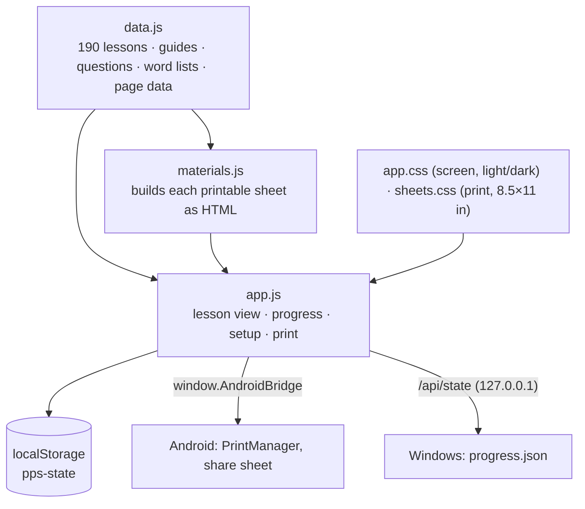

# Architecture

Mom Academy is **one web app** (`web/`) delivered three ways. There is no server and no account. Everything runs on the device.

## The web app (`web/`)

| File | Role |
|---|---|
| `index.html` | App shell: tabs for Lesson, Printables, Year, Circle kit, Checklist and Setup |
| `data.js` | All curriculum content, generated at build time |
| `app.js` | Renders the lesson, saves progress, handles theme, backup and printing |
| `materials.js` | Builds the printable sheets for any day from that week's data (letter, theme, math focus, phase) |
| `sheets.css` | Print layouts measured in inches; always black ink on white paper |
| `sw.js`, `manifest.webmanifest` | Offline caching and "Install app" for the browser version |

**Printing.** Printable sheets are copied into a hidden `#printroot`. Print CSS hides the app and prints one sheet per Letter page. On Android, the page calls `AndroidBridge.print()`, which hands the WebView to the system `PrintManager`.

**Progress.** Progress is saved as one JSON object (days done, ticked parts, checklist, child's name, start date, theme) in `localStorage`. **Setup → Back up** exports it as a file, and **Restore** imports it.

## Android (`android/`)

- `MainActivity.java` shows the app in a `WebView`. Files are served from the APK through `WebViewAssetLoader` at `https://appassets.androidplatform.net/assets/`, which gives a stable, secure origin for storage.
- **JavaScript bridge:** `print(title)` uses `PrintManager` with US Letter. `share(json, name)` saves a backup through `FileProvider` and the share sheet.
- **Dark mode:** `values-night/themes.xml` lets the page's `prefers-color-scheme` follow the phone.
- **Signing:** the release is signed with a fixed key, so each new APK installs over the last one and keeps progress.

## Windows (`windows/`)

- A Go program embeds `web/` with `go:embed` and serves it only on `127.0.0.1:47812`.
- It opens the app in an Edge (or Chrome) `--app` window, so it looks like a desktop app.
- Progress is mirrored to `%APPDATA%\MomAcademy\progress.json`, with a `.bak` copy kept beside it.
- The program stops by itself a few minutes after the window closes (heartbeat ping).

## Content pipeline

The curriculum is written as structured Python data (themes, letters, math per week, sorting sets, word meanings, questions). A build step turns it into `web/data.js`. A Playwright check renders every one of the 1,145 sheets and fails if any content overflows its page.
